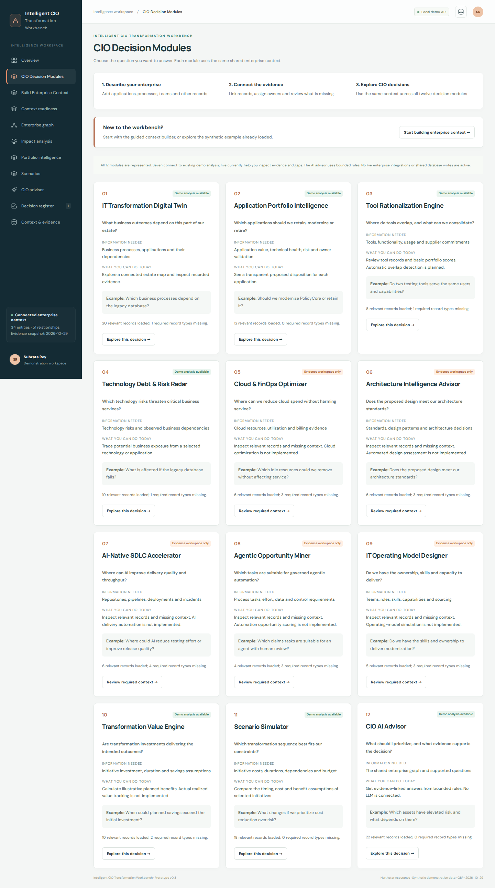
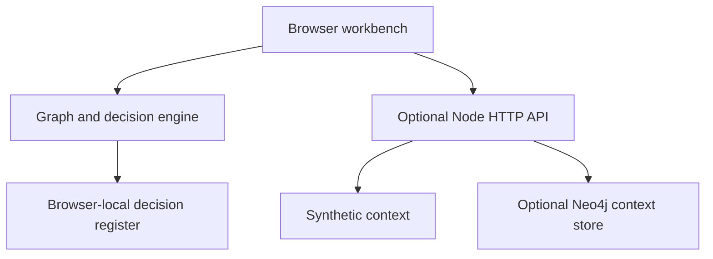

# Enterprise Context Graph + Intelligent CIO Transformation Workbench

A working prototype that connects enterprise strategy, capabilities, processes, technology, risk, investment and outcomes. It helps a CIO explore business impact and compare transformation choices with traceable evidence.

## Preview



## Run in two commands

Requires Node.js 22 or newer. No npm packages or API keys are required for the demonstration.

```sh
cd intelligent-cio-transformation-workbench
npm start
```

Open http://127.0.0.1:4173. Run `npm test` to verify graph traversal, assessment gates, scenario calculations, validation and API behavior.

## What works

- Executive overview with calculated estate metrics and review signals.
- Interactive graph with 1–3 hop exploration, type filtering and evidence inspection.
- Business-impact traversal from technology/application dependencies to business objectives.
- Explainable application and tool assessments with an evidence validation gate.
- Scenario comparison with budgets, implementation delays and initiative dependencies.
- CIO advisor using bounded, deterministic graph and calculation tools with source references.
- Local decision register with rationale, review states and exports.
- Validated JSON import/export and portfolio CSV / executive brief export.
- Optional local Neo4j persistence through a server-side HTTP adapter.

The fictional enterprise is Northstar Assurance. All financial values, lifecycle dates, scores and relationships are synthetic. No real client data is included.

## Demonstration walkthrough

1. Open **Overview** to review the connected estate and transformation priorities.
2. Open **Enterprise graph**, select PolicyCore and inspect the relationship/evidence panel.
3. Open **Impact analysis** and choose Legacy database platform. Follow exposure paths through applications, processes and capabilities to strategic objectives.
4. Open **Scenarios**, compare Balanced, Risk first and Cost first. Observe the reporting initiative's dependency and validation warnings.
5. In **CIO advisor**, ask “What is the business impact of the Legacy database platform?” or “Where is evidence missing?” Open a cited entity.
6. Record a scenario review, enter rationale in **Decision register**, and change its demonstration status.

## Architecture



`dist/` is a complete static application. It can be hosted independently. The local Node server exposes read-only API endpoints and serves the static files. The browser loads the API context when available, otherwise it uses the bundled synthetic context. Graph traversal and scenario calculations execute locally after that snapshot loads.

## Optional Neo4j setup

Requires Docker Compose and a local Neo4j 5 Community instance. This uses Neo4j's HTTP transactional endpoint and does not require a JavaScript driver package.

1. Copy `.env.example` to `.env`.
2. Choose a local password yourself and set `NEO4J_PASSWORD`. Enable `NEO4J_HTTP_URL`, `NEO4J_DATABASE`, and `NEO4J_USERNAME` in `.env`.
3. Run `docker compose up -d` and wait for Neo4j to become ready.
4. Run `npm run seed:neo4j` and then `npm start`.
5. The status badge changes to **Neo4j connected** once context loads successfully.

Seed is idempotent for the included records and scoped to `intelligent-cio-prototype-v1`. It upserts nodes and relationships; it does not delete records removed from a later seed. Neo4j credentials stay on the server. If a configured database is unavailable, the API returns an error rather than silently substituting demo records. The UI remains a clearly labelled browser demo until a valid API snapshot loads.

In Neo4j Browser:

```cypher
MATCH (a:EnterpriseEntity {workspace:'intelligent-cio-prototype-v1'})
      -[r:CONTEXT_RELATION]->(b:EnterpriseEntity)
RETURN a, r, b;
```

Relationships use a `kind` property (for example `DEPENDS_ON`, `SUPPORTED_BY`, `CONTRIBUTES_TO`) and a `state` property (`observed`, `proposed`, or `hypothesis`). Normalized display fields are accompanied by a JSON payload for schema fidelity. This is a prototype persistence model; production requires a richer versioned ontology and temporal model.

## Data contract

Download the sample in **Context & evidence**. Import replaces the browser snapshot, with a maximum of 300 nodes / 1,500 relationships / 2 MB.

```json
{
  "meta": {"name":"Example enterprise","asOf":"2026-10-29","currency":"GBP","synthetic":true,"schemaVersion":1},
  "nodes": [{"id":"app-1","type":"Application","name":"Example app","owner":"Platform owner","source":"CMDB","validated":true,"confidence":"High","annualCost":100000,"health":50,"businessValue":80,"risk":60}],
  "edges": []
}
```

Node types include Objective, Capability, Process, Application, Tool, Technology, Interface, Data, Risk, Initiative, KPI, Team and Contract. Initiative nodes require non-negative `investment`, `annualSaving`, and `durationMonths`. Entity and edge IDs must be unique and references must resolve. The demo supports GBP values only; no currency conversion is performed.

## Decision logic

- Priority v1 = 45% risk + 35% technical weakness + 20% business value. A missing score or absent validation produces a discovery action instead of a decision-ready score.
- Business impact traverses observed `DEPENDS_ON`, `SUPPORTED_BY`, `PERFORMED_THROUGH`, `REQUIRES`, `EXCHANGES_THROUGH`, and `USES` relationships in reverse. Hypothesis and initiative contribution links do not propagate operational impact.
- Scenario selections are deduplicated. Savings begin after completion; selected initiative dependencies delay start dates. Missing predecessors and unvalidated evidence raise warnings.
- Net benefit = savings accrued after completion over the selected horizon minus upfront investment. It is undiscounted and excludes tax, inflation, delivery capacity and additional transition costs.
- Benefits are attached to initiatives; this version does not detect overlapping benefit claims across different initiatives. Reconcile those manually before using real business cases.

## API

| Endpoint | Result |
|---|---|
| `GET /api/health` | Local server health |
| `GET /api/context` | Graph snapshot and source mode |
| `GET /api/summary` | Recorded portfolio metrics |
| `GET /api/impact?id=tech-db` | Observed upstream impact paths |
| `GET /api/advisor?q=What%20is%20our%20total%20annual%20run%20cost` | Bounded tool result |
| `GET /api/scenario?ids=init-policy,init-test&horizon=36&budget=1000000` | Scenario calculations |

The API is local and read-only; imports and decisions remain in browser storage. There is no arbitrary Cypher/SQL endpoint.

## Deployment

For a static host, publish `dist/`. No build is needed. GitHub Pages is enabled through `.github/workflows/static.yml`. Live demo: https://subratatec1.github.io/intelligent-cio-transformation-workbench/

## Prototype boundaries and next steps

This is a decision-support demonstration, not a production enterprise platform. There is no connected LLM, live CMDB/EA connector, enterprise SSO, tenant authorization, server-side decision persistence, or approved financial model. All advisor routing is deterministic and disclosed in the interface. The local server binds to loopback; do not expose it publicly without implementing authentication and authorization.

Next implementation steps: enterprise identity and record-level authorization; authoritative connectors and entity resolution; temporal relationship evidence; production Neo4j schema/indexes; reconciled benefits and scenario constraints; permission-aware document retrieval; model-backed explanations with tool restrictions; authenticated decision workflow and audit.

## Repository structure

```text
dist/                 Static browser application, sample graph and calculation engine
lib/neo4j.mjs         Server-side Neo4j HTTP adapter
scripts/seed-neo4j.mjs Idempotent sample seed
server.mjs            Local read-only API and static server
tests/                Node built-in test suite
docker-compose.yml    Optional local Neo4j
.github/workflows/    Automated Node tests
```

## Twelve modules and context authoring (v0.2)

Open **All 12 modules** for the original capability map. Each module shows its implementation status, evidence requirements, shared records and missing entity types. Dedicated context workspaces do not imply their analytical engines are implemented.

**Context Builder** creates and edits entities and directed relationships with stable IDs, owners, source references, evidence dates, fact state, classification, confidence and owner-validation assertions. Edits persist in browser localStorage and can be exported as JSON. Existing imported attributes are preserved. No writes are sent to Neo4j from the public application.

**Context readiness** measures required entity-type presence, metadata completeness, validation flags, evidence older than 90 days and isolated entities. These checks are not a completeness or accuracy certification. Access classifications are metadata, not authorization enforcement.

`dist/modules.js` defines the 12 modules and their required types. `dist/context-editor.js` validates authored records. Node tests cover graph integrity, evidence validation and coverage updates. The bootstrap workflow also verifies all twelve module routes, authoring, persistence and mobile layout in Chromium.

For a shared enterprise graph, the next backend work is enterprise SSO, record-level access enforcement, authenticated write APIs, audit history, source connectors and entity reconciliation. The existing optional Neo4j adapter provides local reads and sample seeding only.
## Guided context building (v0.3)

The navigation now uses **CIO Decision Modules** and **Build Enterprise Context**. The builder guides users through five steps: choose a context domain; add or import records; connect records; validate evidence; explore relevant decisions. Domains are navigation aids over the same shared graph, not separate databases or access boundaries.

New records receive a suggested stable ID. Field guidance explains owners, evidence, validation and fact states. Users can review specific records from the validation step, then return to relevant decision modules. Unsaved form edits prompt before switching steps or navigating through the workbench buttons. JSON import replaces the current snapshot; exports and saved records remain browser-local.

Every module now explains its required information, today's implemented output and an example CIO question. Seven modules link to existing demo analysis; five provide evidence workspaces only. No additional analytical engines or enterprise backend integrations are implied by this usability update.
